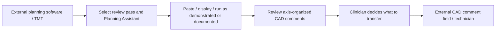
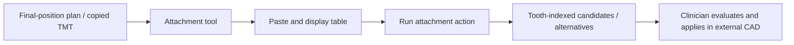
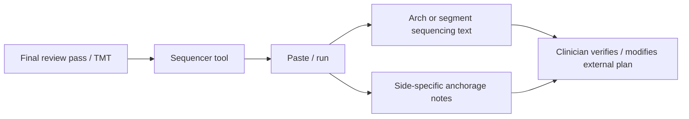

# PMCEASY functional research — Phase 6A

**Observed 14 November 2026, Asia/Karachi. Research only; no application implementation or redesign.**

Finova already has a paste/parser/descriptive-report shell. The major gap is authorization to produce clinically meaningful CAD-change suggestions, followed by the target’s guided interaction and specialist-module outputs. Public demonstrations show substantially more directive content than Finova currently permits. Similar-looking tables would not establish equivalent decision-making, clinical safety or proprietary algorithms.

## Method and evidence boundaries

Sources were limited to PMCEASY’s public pages, their linked marketing assets, the official-linked Plan My Case channel, bounded public demonstration frames, narrowly identified founder-post excerpts, and Finova’s owning source/documentation. No account, purchase, CAD connection, patient upload or private product session was used. A demonstration may show its presenter’s logged-in product; that does not give this investigation authenticated access.

Evidence classes are **PUBLIC PAGE**, **PUBLIC DEMO FRAME**, **INDEXED TRANSCRIPT**, **LOCAL SOURCE/PROBE**, **INFERENCE**, and **UNOBSERVED**. Public-page statements are advertising/documentation. Decoded frames establish visible output in that recording, not general accuracy, repeatability, current availability or the algorithm that produced it. Narration was not independently transcribed; metadata and frame observations are kept separate.

Fresh isolated temporary Chromium profiles were used with scoped origin allowlists. No existing user browser session was attached. No HAR, cookies, storage, tokens, signed media URLs, raw traffic bodies or proprietary application source was exported. Browser/account URL headers were excluded from retained video crops. Preliminary stale-frame captures were discarded; retained timestamps use decoded media-time confirmation. One mismatched-duration media sample was excluded and its image removed rather than attributed to PMCEASY. See the [evidence index](evidence/pmceasy-phase6a/README.md) and capture manifests for limitations and cleanup.

## Source register

| ID | Primary source | Evidence acquired |
| --- | --- | --- |
| P01 | [Homepage](https://www.pmceasy.com/) | Module names, advertised purpose, workflow captions and public image links; isolated rendering/DOM inventory. |
| P02 | [How to](https://www.pmceasy.com/how-to) | Guided modification-pass/tool process. |
| P03 | [Start Planning](https://www.pmceasy.com/start-planning) | Web reader: HTTP 403. Isolated browser: navigation to `/paywall`, blank rendered capture under scoped loading. No working tool exercised. |
| P04 | [Terms](https://www.pmceasy.com/terms-conditions) | Operator describes a subscription website, technician-comment library, attachment and sequencing content. No legal/clinical compliance audit inferred. |
| P05 | [Pricing](https://www.pmceasy.com/pricing-plans/pricing) | Advertised account/tool access, favourites and online device access; no purchase or save/retrieve test. |
| P06 | [Read more](https://www.pmceasy.com/read-more) | Advertised planning resources, monitoring and troubleshooting; private library unobserved. |
| P07 | [About](https://www.pmceasy.com/about) | Operator/product positioning; self-reported experience is not algorithm validation. |
| P08 | [Privacy](https://www.pmceasy.com/privacy-policy) | Public policy only; not proof of actual TMT data handling or security. |
| V01 | [Official-linked video: How does it work?](https://www.youtube.com/watch?v=iEMJeuOXkq4) | Sampled decoded frames: workflow choices, attachment rows and sequencing/anchorage output. |
| V02 | [Official-linked video: Planning with PMCEASY AI](https://www.youtube.com/watch?v=1GHKNwNkL6Q) | Sampled decoded frames: modification menu, axis-organized CAD comments, later CAD comment field and companion attachment table. |
| L01 | [Founder’s launch post](https://tr.linkedin.com/posts/arda-dingiloglu-21880b67_inplasticwetrust-pmceasy-aligners-activity-7194389057609576449-iKSA) | Public/indexed description of comment/attachment libraries and sequencing/malocclusion content; no clinical trigger established. |
| L02 | [Founder attachment demonstration post](https://www.linkedin.com/posts/arda-dingiloglu-21880b67_aligners-orthodontics-artificialintelligence-activity-7206744629927415808-Ar98) | Search-indexed transcript describes separate table-display and attachment actions. Direct web access was robots-denied; no watched narration claimed. |
| F01–F20 | [Finova owning-source audit](evidence/pmceasy-phase6a/finova-audit.md) | Exact path/line references, source hashes, documentation reconciliation and fresh library probes. |

The videos were discovered through the channel linked by PMCEASY’s public pages: [Plan My Case](https://www.youtube.com/channel/UCibaxZc4yIFkitH9zHmy3eg/videos). These are historical published recordings sampled now; their upload dates were not independently recorded. Recorded interface differences are not treated as evidence of the current paid interface. Generic attachment-placement and founder-Q&A videos were discovered as metadata, not used to establish AI-module behavior. [Detailed source/search notes](evidence/pmceasy-phase6a/official-demos.md).

## REA readiness and supported setup

The [REA README](https://github.com/morluto/rea/blob/main/README.md), [browser-observation documentation](https://github.com/morluto/rea/blob/main/docs/guides/web/browser-observation.md), [browser guide](https://rea.tools/guides/browser/) and [installation guide](https://github.com/morluto/rea/blob/main/docs/getting-started/installation.md) were reviewed. **No REA MCP tools are available in this running session.** The shared skill is installed, but a skill is not a connected analysis server. No PATH-resolved CLI or matching registration was found in the inspected user/project configuration layers. This was a bounded check, not an exhaustive search of all accounts/hosts/installations.

Published package metadata at observation time identified REA 6.9.0 and supported Node ranges `^22.23.4 || ^24.22.1 || >=26.12.1`. Local Node is 24.12.0; it is incompatible with that release. No Node/REA installation, package acquisition or Codex configuration edit was performed. The installed skill’s older 6.7.0 examples are not evidence of a working installation. [Published package metadata](https://registry.npmjs.org/rea-agents/latest).

After separately approving acquisition and a compatible runtime, supported proposed steps are:

```powershell
# Proposed only. Use an approved compatible Node, outside the target project.
npx -y rea-agents@6.9.0 doctor --client codex --json
npx -y rea-agents@6.9.0 setup --client codex --dry-run --json
# Review exact proposed paths, backups and matching-skill replacement.
# Apply only after approval of that concrete plan:
npx -y rea-agents@6.9.0 setup --client codex --yes
```

Restart/reconnect and verify actual tools appear. Doctor alone cannot prove an active MCP connection. Website observation needs a Chrome-family browser, not Hopper/Ghidra. Future captures should use an owned dedicated profile, loopback debugging, exact relevant origins and no credential/traffic exports. No setup dry-run ran here, so exact proposed write/backup paths are unknown. The ordinary Playwright observations in this report are **not REA Evidence**, and no REA Evidence IDs are fabricated. [Readiness evidence](evidence/pmceasy-phase6a/rea-readiness.md).

## Product form and overall journey

Primary terms/pricing and the public browser entry support a **browser-delivered subscription website/companion** interpretation. No extension installation, browser injection, CAD plug-in, automatic plan write-back or desktop executable was established. The absence of an extension is also not proven by this bounded investigation. A recorded side-by-side CAD/PMCEASY view establishes window coexistence, not shared internals or an integration API. [P04](https://www.pmceasy.com/terms-conditions), [P05](https://www.pmceasy.com/pricing-plans/pricing), [V02 at 330 seconds](https://www.youtube.com/watch?v=1GHKNwNkL6Q&t=330s).

The public how-to describes choosing a review/modification pass and a tool before pasting/running. It groups broader spatial changes, individual-tooth/attachment/anchorage work, and sequencing/checklist review. These are **planning review passes**, not aligner stage indices. Their count is not a fixed clinical algorithm. Recorded menus also distinguish adult/growing-patient tools; a recorded growing-patient sequencer entry is not yet available in that recording. Current availability and diagnostic eligibility remain unobserved. [P02](https://www.pmceasy.com/how-to), [V01 at 200/280 seconds](https://www.youtube.com/watch?v=iEMJeuOXkq4&t=200s).

### Planning Assistant

The [V02 100s frame](evidence/pmceasy-phase6a/videos/1GHKNwNkL6Q-100s-cropped.png) additionally shows a rendered table with tooth columns/movement rows and an `A.I. Assistant` action underneath. This establishes a visible table-preview/run surface in that recording; it does not reveal the copied text bytes, parser coverage or any independently verified semantics.

Advertised journey: acquire a movement table, run the assistant and use its feedback in CAD communication. The V02 recording shows a modification menu, then a three-row output organized by sagittal, transverse and vertical dimensions. The text mixes quadrant/tooth-group change requests with a whole-case-style reassurance in one dimension. A later CAD field contains matching wording from the earlier output, supporting a transfer workflow; the sampled frames do not show whether transfer was manual, a clipboard button or automation. [P01](https://www.pmceasy.com/), [V02 at 90/120/150 seconds](https://www.youtube.com/watch?v=1GHKNwNkL6Q&t=120s).



The diagram reconstructs intended/documented steps plus sampled outputs; it is not an end-to-end live run. Exact intake serialization, all controls and transfer mechanics remain bounded by the evidence below.

### Attachment Interface

The [V01 210s frame](evidence/pmceasy-phase6a/videos/iEMJeuOXkq4-210s-cropped.png) shows a populated multiline paste area, a `Display Table` button and a rendered movement table underneath. This is direct visual corroboration of the intake/display step, beyond the indexed transcript. The separate attachment-result table is visible later; the sampled frames do not independently time the action or establish every transition.

V01 shows tooth-indexed rows with textual attachment geometry/placement labels, alternatives and explicit no-attachment entries. Sizes, shape/orientation terminology and named optimized options are visible. This is a richer output contract than a movement-description list. **The sampled companion output is a table, not evidence of a dedicated 3D attachment renderer.** The adjacent 3D dental model in V02 belongs to the external CAD software. Instructions about running after final tooth positioning appear in a recorded tool menu. [V01 at 200/220/240 seconds](https://www.youtube.com/watch?v=iEMJeuOXkq4&t=220s), [V02 at 330 seconds](https://www.youtube.com/watch?v=1GHKNwNkL6Q&t=330s).



The separate display/action sequence is narrated in the indexed founder transcript, not independently exercised here. Neither attachment necessity, geometry validity nor automatic placement was established. [L02](https://www.linkedin.com/posts/arda-dingiloglu-21880b67_aligners-orthodontics-artificialintelligence-activity-7206744629927415808-Ar98).

### Sequencer

V01 shows arch/segment sequencing text and separate right/left anchorage notes, including case-specific auxiliary advice. The sampled output is a **labeled textual report**, not an observed numbered stage schedule, timeline export or simulation. The menu places sequencing at the final modification pass. No force/anchorage instruction in the demo is an approved Finova rule. [V01 at 280/330 seconds](https://www.youtube.com/watch?v=iEMJeuOXkq4&t=330s).



The website advertises collision/treatment-time benefits. No public evidence here establishes a collision engine, 3D path validation, numerical optimization, measured duration prediction or successful clinical outcome. Total TMT values cannot establish these by themselves. [P01](https://www.pmceasy.com/); Finova’s governing restrictions remain in [corrected v2](docs/FINOVA_RULE_ENGINE_V2_AUDIT_CORRECTED.md).

## Original homepage screenshot register

All eight linked original assets failed to load from `static.wixstatic.com` through the web reader, direct HTTP and isolated browser, with connection resets or fetch failures. The homepage capture contains placeholders. **No cell, control or recommendation was transcribed from those missing originals.** Captions identify intended roles only. Complete public URLs and diagnostics are in [the source manifest](evidence/pmceasy-phase6a/public-capture-manifest.json).

| ID / linked asset | Module / intended step | Observable from original image | Reasonable inference / unknowns |
| --- | --- | --- | --- |
| S01 / TMT.jpeg | Shared external-table copy step | UNOBSERVED pixels | Caption identifies a TMT illustration; numbering, source/version, units and actual serialization unknown. |
| S02 / TMT paste.jpg | Planning intake | UNOBSERVED pixels | Caption identifies paste/run; all actual field/button/layout details unknown from this asset. |
| S03 / comments.png | Planning output | UNOBSERVED pixels | Caption identifies comments; actual text, grouping and copy/share controls unknown from this asset. |
| S04 / functional.png | Functional-treatment promotion | UNOBSERVED pixels | Feature is advertised; diagnosis/input/output/prerequisites not established by this image. |
| S05 / aiai paste.png | Attachment intake | UNOBSERVED pixels | Caption gives role only; actual controls and requirements unknown. |
| S06 / aiai output.png | Attachment output | UNOBSERVED pixels | Pixel-level shape/size/orientation/interaction cannot be established here. V01/V02 are separate evidence. |
| S07 / ai sequencer.png | Sequencer intake | UNOBSERVED pixels | Actual fields, stage input and options unknown. |
| S08 / ai sequencer output.png | Sequencer output | UNOBSERVED pixels | Actual schedule/notes/controls unknown from this file. V01 supplies a recorded textual-output example only. |

## Independently viewable demonstration evidence

Native privacy-cropped frames are retained as research evidence. Timestamps are decoded media timestamps, not merely requested player positions. URL/profile/account headers are excluded; unrelated/stale captures were removed. Small cut-off text is not reconstructed. Publication versions may differ from today’s inaccessible paid product.

| Evidence | Visible input/output and controls | Limits / interpretation |
| --- | --- | --- |
| [V01 200s crop](evidence/pmceasy-phase6a/videos/iEMJeuOXkq4-200s-cropped.png) | Links for adult/growing-patient Planning Assistant and Attachment Interface; ordered module menu; timing guidance for attachment use. | Selection menu only. Does not verify patient classification or current availability. |
| [V01 220s crop](evidence/pmceasy-phase6a/videos/iEMJeuOXkq4-220s-cropped.png) | Two-column tooth/attachment table, alternatives and textual geometry/placement labels. | No actual attachment-plan import, geometric validity or 3D companion renderer observed. |
| [V01 210s crop](evidence/pmceasy-phase6a/videos/iEMJeuOXkq4-210s-cropped.png) | Multiline intake, display action and movement-table preview. | Visible example text is not an authentic clipboard artifact or verified vendor map. |
| [V01 240s crop](evidence/pmceasy-phase6a/videos/iEMJeuOXkq4-240s-cropped.png) | Continuation rows, explicit absence entries and further candidate labels. | Example tooth tokens are literal strings, not verified numbering-system mappings. |
| [V01 280s crop](evidence/pmceasy-phase6a/videos/iEMJeuOXkq4-280s-cropped.png) | Sequencer menu and final-pass guidance; an unavailable growing-patient entry in the recording. | Cannot establish present-day feature availability from this historical frame. |
| [V01 330s crop](evidence/pmceasy-phase6a/videos/iEMJeuOXkq4-330s-cropped.png) | Lower-arch sequencing statements; separate right/left anchorage sections; one side contains auxiliary instructions and the other a negative-need statement. | No stage IDs/timeline or validated force model is visible. These are displayed recommendations, not validated prescriptions. |
| [V01 300s crop](evidence/pmceasy-phase6a/videos/iEMJeuOXkq4-300s-cropped.png) | Upper/lower arch sequencing rows and anchorage section; strategic/protocol language rather than numbered stage allocations. | Visible percentages/protocol/force examples are not adopted as limits, algorithms or recommendations. |
| [V02 90s crop](evidence/pmceasy-phase6a/videos/1GHKNwNkL6Q-90s-cropped.png) | First-modification menu with dimensional/manual content links and growing-patient assistant option. | No fixed three-pass algorithm or diagnostic assessment inferred. |
| [V02 120s crop](evidence/pmceasy-phase6a/videos/1GHKNwNkL6Q-120s-cropped.png) | Axis-organized output: sagittal strategy/IPR/auxiliary/root-control requests, transverse-change request, vertical reassurance. | Visible numeric examples are not adopted as thresholds, validated limits or rules. Their hidden input and justification are unknown. |
| [V02 100s crop](evidence/pmceasy-phase6a/videos/1GHKNwNkL6Q-100s-cropped.png) | Rendered tooth-column/movement-row table and assistant action. | Table pixels do not establish original clipboard formatting, normalization or unit/sign rules. |
| [V02 150s crop](evidence/pmceasy-phase6a/videos/1GHKNwNkL6Q-150s-cropped.png) | External CAD comment textarea with matching wording and a visible movement table underneath. | Supports cross-application communication; does not prove an API/extension or authentic clipboard serialization. |
| [V02 330s crop](evidence/pmceasy-phase6a/videos/1GHKNwNkL6Q-330s-cropped.png) | CAD model alongside the companion’s tooth-wise attachment table and attachment action label. | A multi-window workflow, not proof the companion owns CAD geometry or applies changes automatically. |

Limited **screenshot transcriptions**, not clipboard exports or clinical rules: V01 rows include headers `Tooth no.` / `Attachment`, and token `1.7` alongside `NO ATTACHMENT`. V02 output uses `Axis`, `Sagittal`, `Transversal`, `Vertical`; one row says **“The case is within predictable limits.”** That statement is evidence of target wording only. Finova must not reproduce such reassurance from unverified TMT. Numeric treatment directives are intentionally not turned into a policy, fixture oracle or prescription.

Three retained context frames—V01 150/180s and V02 240s—show external CAD geometry/plan controls only. They do not establish a PMCEASY algorithm, additional module or automatic integration. All retained frames, their public URLs, observations and unknowns are itemized in [the screenshot observation register](evidence/pmceasy-phase6a/screenshot-observation-register.json). The failed V02 105/110s attempts were excluded on media-identity/duration mismatch; no image from those attempts was retained. Publication/source-version coverage remains limited.

## Current Finova implementation, checked independently

All 20 project/governing/report/verification Markdown documents were loaded in full (703,551 bytes), with hashes and table/section inventory retained in [the document/source manifest](evidence/pmceasy-phase6a/finova-document-source-inventory.json). The audit, corrected v2, architecture blueprint and prior implementation reports were reconciled against owning frontend/backend contracts. The standalone original 82-rule research document remains missing; corrected trace paragraphs do not authorize legacy triggers. Root and `docs/` Phase 4 reports differ, so current source and fresh probes take precedence over a filename or historical progress claim.

Source inspection confirms the React/FastAPI standalone workflow, exact raw/Decimal evidence, explicit parse/review/report actions, separate unavailable assessments, complete rule ledger and local whole-report copy/TXT. It also confirms no specialist-module implementation, per-comment editing/selection, CAD write-back, extension, authenticated sign-off or persistence. Groq selects closed wording alternatives for eligible synthetic findings; it does not decide clinical triggers. Current vendor releases are empty and the public review/report handlers admit no checked semantic fixture.

The Phase 4 cloud fallback proposes structural associations only and is restricted to server-reproducible generated synthetic fixtures. It is not unrestricted fallback for arbitrary pasted tables and grants no vendor semantic authority. The separate report-wording service retains its real-patient transmission gate; future semantic approval would not itself authorize patient cloud processing.

Fresh synthetic **library/model** probes (not a new HTTP/browser/full-suite run) exercised tooth rows, tooth columns, Markdown, unsupported unanchored input, vendor claims and trust-injection rejection. Recognized tables retained raw text/Decimal precision; all public-style reviews stayed UNVERIFIED with zero eligible movement observations, 96 ledger entries and template-only abstention reports. Provider generation was patched to fail if invoked; provider calls were zero. The runtime registry remains 66 active engineering guards/handlers, 27 disabled clinical predicates and 3 deferred controls. [Probe results](evidence/pmceasy-phase6a/finova-local-probes.json).

The most consequential missing implementation is a **validated generalizing vendor adapter plus production evidence admission/lookup**. Existing exact-curated-fixture projection is not that adapter. Authentic samples and policy approvals are required, but simply adding a release digest or setting a flag would not make arbitrary new pasted tables normalize. Prior Phase 5 test counts are historical and are not presented as fresh verification or clinical validation.

Public page inventories contain declared script URLs, not script source or execution coverage. Wix/React-related public-shell resources do not reveal the assistant’s AI model, server logic or clinical architecture. No proprietary server algorithm was reconstructed.

## Planning comment classes and Finova rule mapping

| Publicly supported class | Evidence strength | Finova descriptive basis / candidate policy / safeguards |
| --- | --- | --- |
| Dimension-organized CAD-change requests with localized tooth/quadrant content | V02 output pixels | D01/D07/D08/D09 supply conditional observations; R09/R10/R11 remain disabled; G/N enforce source/field context. Report axis-category presentation is missing. |
| Root-control/overcorrection language | V02 output pixels | D06 is only angular description. R07 requires policy/geometry/context; H03 and N08 prevent inferring root/bone safety or valid composition. No visible demo percentage is an approved parameter. |
| IPR and interarch auxiliary/anchorage strategy | V02 output and V01 anchorage pixels | H05/H11 withhold; T07/T08 and R10/R11 require independent plans/examination/stages/geometry and approved strategy. A total TMT cannot justify these. |
| Dimensional whole-case reassurance | V02 output pixels | D12 counts do not establish predictability. R14/R16/H01/H07 require abstention or separately validated clinical assessment; absence of a flag is not a normal result. |
| Rotation, extrusion/intrusion and movement-specific risk categories as distinct generated comments | UNOBSERVED in the sampled Planning Assistant output | D03–D06 and R01–R08 are potential Finova families, **not a discovered PMCEASY rule list**. Additional target observations are required before claiming category parity. |
| Tooth-wise attachment recommendations and alternatives | V01/V02 attachment pixels | R15/A01–A04 remain disabled; A05/A06/H08 withhold placement/superiority claims; actual plans/geometry/policy required. |
| Arch/segment sequencing and side-specific anchorage | V01 sequencer pixels | G15/N07 validate supplied stage descriptions only. R13/T01–T08 remain disabled; no stages or force strategy can be derived from totals. |

Finova can already generate exact descriptive inventories, compatible-context co-programming/distribution and localized abstentions **when evidence is admitted**. Its public routes currently admit no approved vendor semantics, so fresh probes returned no authorized movement observations and template-only abstention reports. These conditions must not be hidden by interface simplification. The full D/R/T/A mapping and exact source references are in [the Finova audit](evidence/pmceasy-phase6a/finova-audit.md).

Potential future TMT-based **review flags**, rather than treatment prescriptions, could compare a verified source-defined movement/tooth group against an exact orthodontist-approved policy (for example the R01/R02/R03/R04/R05/R08 preparation categories). That remains conditional on group/arch, applicability/exclusions and any other required evidence; no category or cutoff is approved now. Current prerequisites/readiness and illustrative comparator plumbing are not complete clinical predicates. IPR, auxiliary force strategy, root-control prescriptions, biological safety, achieved movement and whole-case reassurance require additional clinical/geometry evidence or may remain inappropriate for TMT-only output. This is an independent Finova feasibility assessment, not discovery of PMCEASY's hidden rule list.

## What remains unknown

- Current paid module controls, complete patient-context questionnaire, all outputs, undo/error/empty/duplicate behaviors and account persistence.
- Exact supported clipboard formats, platform/build/locale matrix, numbering/dentition, signs/directions, plan modes and crown/root/cusp or stage semantics.
- Whether content is rules, a library, LLM output or a hybrid; thresholds, evidence base, model/provider, prompts and validation/performance.
- The full source of each demonstrated directive, off-screen examination/context, attachment plans, geometry and clinician modifications.
- Per-comment copy/select/edit, automatic sending, report/export formats, favourite retrieval, direct CAD integration and extension distribution.
- Any validated collision, anchorage/force, achieved-movement, treatment-duration or clinical-outcome claim.

These unknowns are not silently filled with Finova’s design or marketing assumptions. The [gap matrix](PMCEASY_FEATURE_GAP_MATRIX.md) separates missing UI from data/clinical barriers; the [roadmap](PMCEASY_RECONSTRUCTION_ROADMAP.md) proposes an independent implementation sequence, subject to review. No implementation phase has begun.

## Deliverable verification and stopping point

Artifact checks verify three reports, all 23 GAP cards with eight requested attributes each, 15 decoded/registered privacy-cropped frames, eight explicitly unavailable original screenshot sources and no broken local links in the three reports. The 23 inspected application-source snapshots remain unchanged. The evidence inventory includes file identities/hashes and native capture provenance; it is not a clinical fixture set. [Artifact validation](evidence/pmceasy-phase6a/research-artifact-validation.json), [file inventory](evidence/pmceasy-phase6a/evidence-files.json).

No parser, rule-engine, frontend, dependency, environment, Codex configuration or Groq implementation change was made for this research. No disabled policy was activated. Existing Graphify was queried for owning-source navigation; the required AST-only index refresh covers research recipes without semantic/LLM extraction of documents or images. No new full test-suite/build/deployment success is claimed. This completes the bounded public research and gap assessment; paid-runtime and clinical unknowns remain explicit, and implementation waits for review.
