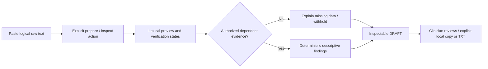

# Independent reconstruction roadmap — proposed after Phase 6A review

**14 November 2026. Planning document only. No phase below is authorized or started by this report.** The [research report](PMCEASY_FUNCTIONAL_RESEARCH_REPORT.md), [gap matrix](PMCEASY_FEATURE_GAP_MATRIX.md) and [evidence folder](evidence/pmceasy-phase6a/README.md) separate public observations from inference and unknowns.

Complete the Planning Assistant before building Attachment Interface or Sequencer. Reuse Finova’s parser/provenance, semantic state machinery, deterministic rule contracts, output validation and DRAFT export. Do not copy PMCEASY branding, visual assets, application source or protected content library. Do not use unrestricted LLM clinical reasoning to fill evidence gaps.

## Proposed implementation sequence

| Step | Purpose and deliverable | May use existing evidence now | Gate before proceeding |
| --- | --- | --- | --- |
| 1. Close workflow evidence | Confirm current intake/actions, output grouping and transfer mechanics; maintain observation ledger | Public decoded demos and documentation, with version limits | Review this report; any authenticated observation requires lawful existing entitlement and authorized access |
| 2. Planning workflow MVP | Independent compact paste → inspect → descriptive draft → local export flow, clear unavailable states | Existing synthetic parser/review/report pipeline | Explicit implementation approval; no clinical-policy activation or patient cloud permission |
| 3. Verified vendor normalization | Reviewed generalizing source/version adapters and production evidence admission/lookup | Existing exact-fixture verification models and empty release registry | Authentic dual-reviewed captures, approved deterministic mappings and independently tested implementation |
| 4. Planning clinical policies | A small individually justified subset of review suggestions, not wholesale imitation of demo directives | Existing disabled R/T/A preparation and H/L/N safeguards | Qualified orthodontist-approved trigger/applicability/exclusions/wording, necessary external data, shadow evaluation and controlled release |
| 5. Attachment module | First a synthetic option-table prototype; then separately validated indications/geometry | Existing tooth/measurement provenance and disabled A contracts | Planning Assistant accepted first; actual plans/geometry, policy, evidence and interface review |
| 6. Sequencer module | First a synthetic arch/segment report; then any approved staging/anchorage subsystem | Existing explicit stage-kind/order contracts and disabled T rules | Actual staged/geometry/clinical data and separately validated strategy/operations; no totals-derived schedule |
| 7. Broader product surfaces | Optional resource library, favourites, identity/sign-off, collaboration or integration | Current reports and audit requirements | Independently authored content, evidence-backed user need, privacy/security and access/retention design; separate approval |

Steps 2 and a synthetic presentation prototype can be engineered without inventing clinical rules. They do **not** complete clinical functional parity. Steps 3–4 are substantive missing systems, not configuration toggles. Some target recommendations may remain inappropriate to reproduce even after more UI evidence is collected.

## 1. Target observation closure

Use a reviewed checklist against the current entitled product only if access is later provided lawfully. Do not sign up, buy access or install an extension without the relevant instruction. No authentication bypass is proposed. REA is optional: public browser observation already supplied useful evidence. Its separate runtime/package/configuration changes require prior approval; exact steps and current incompatibility are in [REA readiness](evidence/pmceasy-phase6a/rea-readiness.md).

Record:

1. Product/tool/version and observation date; distinguish review/modification pass, adult/growing branch, plan mode and actual aligner stage.
2. Each intake control, display/run sequence, declared supported source formats and necessary context; original de-identified clipboard bytes only under an appropriate capture/consent process.
3. At least one complete output for each intended Planning Assistant category, plus zero/missing/malformed/conflicting/unsupported examples. Screen pixels alone are not semantic gold.
4. Copy/edit/select/save/share/export controls and the actual route into CAD comments; do not infer automation from matching text or adjacent windows.
5. Whether comments originated in generated output, an educational library, manual clinician edits or off-screen clinical context.
6. For attachments, whether output is only textual rows or includes independently manipulable diagrams; actual candidate/alternative/omission semantics.
7. For sequencing, whether any real stage schedule exists, or only arch/segment instructions and anchorage notes. Validate current availability of branches seen as unavailable in older recordings.

Keep tokens, account/patient identifiers, cookies, unrelated traffic and private code out of retained evidence. The failed homepage-image downloads remain explicit limitations, not an excuse to invent unreadable content. Additional screenshots should be native captures with provenance, never AI-enhanced reconstructions.

## 2. Planning Assistant workflow MVP

### Proposed user journey

This is an independent Finova design proposal, not an exact target wireframe. A combined action may orchestrate existing steps, but must not introduce implicit cloud transmission, automatic retries or a trusted client-side finding payload. Preserve raw text, receipt/context binding, abort/invalidation behavior and deterministic fallback. Separate the compact user view from complete technical provenance; keep relevant evidence accessible.

### Engineering MVP acceptance criteria

- One understandable journey with accessible loading/error/empty/partial states; no misleading success when evidence is unavailable.
- Existing irregular-spacing/Unicode/blank-line/raw preview and exact Decimal behavior preserved.
- Clear distinction between raw/lexical values, authorized canonical descriptions, clinician-authored notes and unavailable clinical suggestions.
- Compatible grouping that can present dimensional/tooth/local summaries without claiming that source axis labels prove clinical sagittal/transverse/vertical outcomes.
- Each generated description links to immutable finding/rule versions, exact supporting measurement and verification/missing fields.
- Ordinary unverified vendor input still withholds measurements/clinical advice. No HTTP/browser/environment mechanism promotes TEST_ONLY evidence.
- Whole-report copy/TXT retained. Any proposed compact/selected export keeps DRAFT, scope and provenance; per-comment controls are a Finova UX proposal until current target behavior is verified.
- Any clinician editing preserves the original engine finding and labels amendments as user-authored; changes invalidate prior approval. Authenticated final sign-off remains a separately designed N11/L06 workflow.
- No persistence, unrestricted model reasoning, attachment/IPR/anchorage prescriptions, predicted outcomes or stage synthesis added to this engineering MVP.
- Regression tests cover raw preservation, abort/stale-result invalidation, source/semantic gates, partial abstention, exact values, closed output wording and copy/download. Passing them proves software behavior, not clinical validation.

Synthetic demonstrations may use existing offline/library-bound TEST_ONLY fixtures or clearly separate precomputed illustration assets. A production request flag must never grant synthetic semantic authority or clinical approval. A synthetic diagram/table must be labeled illustrative, and an example parameter must not become a default clinical policy.

### Clinical Planning Assistant completion is a separate gate

An engineering MVP may be usable for descriptive/internal synthetic review while clinical parity remains blocked. Before a specific CAD-change suggestion can be called implemented for vendor input, require:

1. Independently released source/version/notation/dentition/axis/unit/sign/direction/mode/basis/scope/frame mappings and a validated generalizing adapter/admission path.
2. Verified tooth group/status, arch, objectives and all rule-specific external context. Missing fields remain UNKNOWN; absence is not an indication.
3. Exact signed/versioned orthodontist policy, scope/exclusions, comparator or categorical logic, severity and qualified wording. Neither a demo value nor historical manufacturer band is approval.
4. Independent preregistered multi-reader shadow evaluation, adjudicated critical misses/over-flags, output/provenance checks and formal change-controlled release/rollback.
5. Intended-use/privacy/security/governance review before actual clinical input processing or provider transmission. Existing synthetic-only cloud limits remain in force until a separately authorized implementation and review.

Finova’s current D descriptions can support evidence displays; disabled R candidates are not already-developed clinical predicates. Begin, if approved, with a narrowly defined evidence-supported review question. Do not begin with IPR, elastics, root overcorrection, functional diagnosis, whole-case reassurance or all target output classes at once. Unsupported predicates remain disabled rather than replaced by an LLM decision.

## 3. Vendor semantic verification work package

Authentic fixtures are necessary but insufficient. The current library projects exact curated assertions and public handlers supply no checked fixture; a released digest alone cannot normalize new pastes. Specify and test a **generalizing versioned adapter and controlled evidence admission/lookup** in a future approved task.

For each intended ClinCheck/SureSmile version/copy surface/locale, obtain original de-identified clipboard artifacts plus source UI evidence and independent reviewers. Cover both arches, mirrored directions, each supported notation/dentition, every axis/unit/sign variant, explicit zero versus missing, modes, crown/root/cusp bases and stage/total scopes. For ClinCheck, identify actual final/comparison operands and operations; for SureSmile, distinguish cumulative/incremental and actual stage kinds/indices/arch correspondence. Record unsupported variants instead of inventing them. The precise existing checklist is in [vendor verification](backend/vendor_verification/README.md).

Expected outputs must bind each semantic assertion to source evidence and preserve original identifiers, values, precision and spans. Test incompatible bases/frames, partial abstention, unknown versions/layout drift, duplicate/conflicting fields and comparison-as-absolute rejection. Do not enroll a screenshot transcription or a generated example as an authentic clipboard oracle. Production additional-context admission needs equivalent independent verification, not a user claim or a private TEST_ONLY object.

## 4. Attachment Interface roadmap

**Observed baseline:** tooth-indexed textual candidates/alternatives and geometry/placement labels. A dedicated target 3D renderer, automatic CAD placement and validity of attachment omission are unobserved. Start with an independently designed table, not an assumed 3D replica. [V01 at 220 seconds](https://www.youtube.com/watch?v=iEMJeuOXkq4&t=220s).

**Required inputs:** verified vendor/source/version, tooth identity/dentition/status and movements; actual attachment-tooth/surface/stage plan including intentional removal; plan mode/stage conventions; independently verified crown/root/reference geometry and placement surfaces where geometry is claimed; approved clinical indications and comparative evidence for alternatives.

**Proposed output contract:** tooth/source references; candidate ID and independent catalogue/design provenance; action (`WITHHOLD`, later approved place/modify/remove/not-indicated); alternatives with relationship/reason; shape, Decimal dimensions and units; orientation/placement frame and surface reference; stage applicability; field-level verification; missing prerequisites; policy/evidence versions; DRAFT status. Geometry fields remain null/UNKNOWN without evidence. Unknown must never render as no attachment. Removal/modification requires an actual verified plan, not a TMT absence.

**Suggested presentation:** tooth-wise rows with evidence, alternatives and explicit unavailable states. Optional independent schematic symbols can be prototyped synthetically; a 3D model is a separate geometry-backed feature, not a requirement proven by the public table. Do not reuse target graphics or optimized-design assets. Keep any application to external CAD a clinician-controlled step unless a separately authorized/observed integration is justified.

**Reuse:** parser/provenance, field states, rule registry and A/H safeguards, exact local rendering, DRAFT export, disclosure/invalidation patterns. **Missing:** actual-plan intake, clinically verified indication logic, geometry catalogue/frames, omission/change semantics and module-specific validation. A05/A06 remain withholding safeguards; no universal attachment superiority or automatic placement follows from a readable TMT.

## 5. Sequencer roadmap

**Observed baseline:** labeled arch/segment sequencing text and side-specific anchorage notes. A numbered stage timetable, downloadable simulation, automatic optimization or collision-validation engine was not observed. Begin any synthetic presentation prototype with this textual structure, not an invented target timeline. [V01 at 300/330 seconds](https://www.youtube.com/watch?v=iEMJeuOXkq4&t=300s).

**Required inputs:** actual stage datasets with original IDs/indices/kinds/arch correspondence, baseline/endpoints and device configuration history; independently verified paths and tooth/arch/contact/root geometry; intended anchorage/force strategy and clinical/examination/objective constraints; approved IPR/contact/enamel plan if relevant. Total values do not supply timing, simultaneity, biological support, collision clearance or treatment duration.

**Proposed output contract:** arch/segment/tooth references; actual supported stage window or null; source movement scope; approved strategy ID and qualified clinician/technician note; anchorage side/context or withheld state; verification/provenance, missing prerequisites, conflicts and policy versions. Any future geometry assessment must identify its validated model and limitations. No default collision-free flag, derived stage allocation, scalar angular sum or outcome/time prediction is proposed.

**Suggested presentation:** distinct sequencing and anchorage sections with clear evidence/withholding states. Add a timeline only if a later approved requirement and actual stage data justify it; it is not established target parity. Explicitly separate user-authored intended sequence from computed, approved observations.

**Reuse:** G15/N07 stage consistency, N08 composition prohibition, field-local eligibility, T/R preparation metadata, exact DRAFT reports and output safeguards. **Missing:** stage ingestion/admission, validated operations/contact engine and clinical strategy/policy. T01–T08 remain disabled until their individual prerequisites and evidence gates close. Force, wear and negative-anchorage statements shown in a public recording are not Finova prescriptions.

## Decision gates and remaining evidence requests

| Can reproduce independently after review | Can illustrate synthetically | Needs authorized target observation | Needs verified vendor semantics | Needs approved clinical policy/data |
| --- | --- | --- | --- | --- |
| Guided interaction, compact descriptive grouping, inspectable draft, local export | Option tables, module navigation, unavailable/partial states, textual sequencing layout | Current controls, edit/copy/save/share behavior, all branches, actual extra-context intake and format support | Anatomical/canonical movement descriptions on new vendor pastes, stage/reference/mode equivalence and source drift handling | Any modification/omission/attachment/anchorage/IPR/sequence/functional/predictability recommendation |

Request, when a future phase is approved: current entitled walkthroughs with safe de-identified examples; consented authentic vendor artifacts and dual-review codebooks; rule-specific additional clinical/geometry/stage inputs; exact qualified policy approvals and a validation protocol. The missing standalone original 82-rule document remains a historical traceability limitation; the independent audit/corrected v2 govern and no legacy trigger is resurrected.

Do not expand into authentication, case persistence, extension development, CAD automation, unrestricted LLM reasoning, attachment prescriptions or sequencing implementation under the current research authorization. Review the Phase 6A findings first. This roadmap is the stopping point for this phase.
